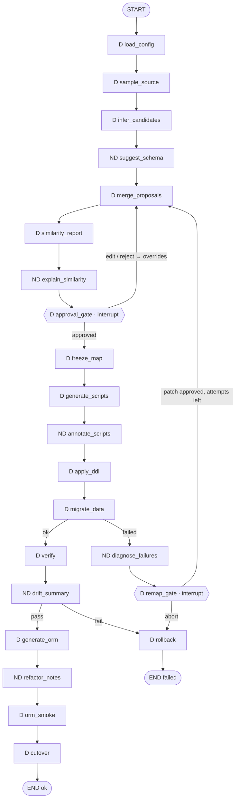

# ARCHITECTURE.md — SchemaShift

## 1. System context (Docker Compose)

```
┌───────────────────────────── docker compose ─────────────────────────────┐
│  mongo:7 (source)  ◄── read-only ──┐                                       │
│                                    │                                       │
│  schemashift (python 3.12, CLI) ───┤── LangGraph pipeline ──► postgres:16  │
│     │  Typer + Rich TUI            │        (target, write via             │
│     │  SQLite checkpoints          │         deterministic loader only)    │
│     └─ /workspace (volume) ◄───────┘                                       │
│          out/{migrations,etl,orm,reports,state}                            │
│  tests (profile: test)  → pytest integration + e2e against the two DBs     │
└────────────────────────────────────────────────────────────────────────────┘
        optional egress: LLM provider (only the `anthropic` provider uses it)
```

Services: `mongo`, `postgres` (both with healthchecks), `schemashift` (entrypoint = the CLI), `tests` (profile `test`). Config comes from `workspace/schemashift.yaml` plus env interpolation (`${MONGO_URI}`, `${PG_URI}`); no credentials in files.

## 2. Pipeline graph (LangGraph)

`D` = deterministic node, `ND` = non-deterministic assist node, `{{ }}` = human-in-the-loop interrupt.



Rules: loops are bounded (`max_remap_attempts`, default 2). Re-running after a remap **always** passes through `merge_proposals → similarity_report → approval_gate → freeze_map` so the schema map is re-frozen (version + 1, new hash) before any script is regenerated. `apply_ddl` runs the generated *down* script first when `reset_target: true`, so a retry starts clean. `cutover` is deterministic: it writes `orm/app.env` with `DATA_BACKEND=sql` and `reports/CUTOVER_CHECKLIST.md`.

Graph state holds only small scalars, file paths and hashes (profiles, maps, reports live in `workspace/out/`), keeping SQLite checkpoints small and resumable across processes.

## 3. Hybrid contract per layer

This table is the source for the README table (A19 copies it verbatim and adds a real match-% example).

| Layer | Deterministic side (owns truth + side effects) | Non-deterministic side (assist only) | Why this split | Safety gate | Match-% |
|---|---|---|---|---|---|
| Inspect / Infer | Systematic sampling, type stats, rule-based nesting/reference/key/type decisions, frozen candidate fields | LLM proposes names, relations, embed-vs-table for ambiguous cases | Structure is computable and must be reproducible; naming/semantics are judgment | Proposals pass rule validators; structural proposals always need approval; freeze only after gate | Candidate coverage feeds layer 2 |
| Similarity / Match % | Normalization + token/fuzzy/type/structure scoring → recomputable % | LLM explains why scores look so and flags ambiguous pairs; optional embeddings only *flag* | A % that can't be recomputed can't be trusted | Score < 0.85 or ambiguity → human approval | **Produced here**: overall, per entity, per field, banded |
| Script generation | Jinja templates from the frozen map → DDL, ETL plan, rollback (same map → same bytes) | Risk notes + migration summary in sidecar `*.notes.md` | Scripts are production side effects | Generators refuse a map whose hash doesn't verify; ND text never enters script bodies | Report header embedded in notes |
| Data migration | FK-ordered batch loader, retries for transient errors, typed transforms | Diagnoses failed rows, suggests a remap patch | Loading must be safe and repeatable | A patch applies only after approval + re-freeze + re-run | Per-table load stats |
| Verify / rollback | Counts, checksums, seeded spot-checks, orphan scan, rollback SQL | Summarizes drift and likely causes | Pass/fail must be objective | Pass/fail computed by code only; rollback is deterministic | — |
| ORM migration | SQLAlchemy models, repositories, db setup from the frozen map | Query-idiom and refactor notes | Runtime code must match the schema exactly | `py_compile` + import + CRUD smoke; ND notes are sidecar for human review | — |
| Orchestration | Execute/verify/cutover nodes, routing, bounded loops, checkpoints | suggest/explain nodes, HITL interrupts | Control flow must be explicit and auditable | Interrupts at approval and remap; CI auto-approve recorded and limited | Report emitted before approval |

## 4. Determinism and LLM boundary rules

1. **Structured only:** every LLM response is parsed into a pydantic model (`contracts/llm.py`); invalid output is discarded and the deterministic fallback runs.
2. **Proposals, not writes:** LLM proposals enter `assist/merge.py`, which accepts a proposal only if validators pass (legal unique identifier, name similarity ≥ 0.5 for renames, type compatibility, no cycle/collision). Accepted items are tagged `provenance: llm_proposed_validated`.
3. **Sidecars:** narratives are written to `*.notes.md` / `explanations.md`. They are excluded from `map_hash` and from script bodies.
4. **No handles:** `assist/` and `llm/` receive redacted profile summaries (≤ 3 hashed/truncated examples per field) and never a Mongo/Postgres connection or credentials.
5. **Replay cache:** `llm/cache.py` keys on `sha256(provider|model|prompt)`; `replay` provider serves only from the committed cache and errors on a miss.
6. **Provider `none`:** `assist/fallbacks.py` produces templated narratives from the same inputs; the pipeline output (map, scripts, ORM) is identical to the LLM-on run.
7. **Deterministic sampling:** documents ordered by `_id`; if `count ≤ sample_size` full scan, else systematic stride sampling (`stride = ceil(count / sample_size)`). No `$sample`.

## 5. Inference rules (deterministic)

| Source shape | Rule | Result | Base evidence |
|---|---|---|---|
| Collection | one root table | `<snake_plural>`, PK `id CHAR(24)` | always |
| Scalar field | type map (§6) | column | type purity |
| Nested object, always present (≥ 0.98), stable keys, flattened width ≤ `embed_max_fields` (8) | flatten | `<parent>_<child>` columns (recursive) | presence rate |
| Nested object, sparse or wide or unstable key set | 1:1 child table or JSONB (`jsonb_variance_threshold`) | `<parent>_<field>` | key-set stability |
| Free-form object (high key variance, unbounded keys) | JSONB | `jsonb` column | key variance |
| Array of scalars | child table | `<parent>_<field>(id, parent_id FK, position, value)` | array length stats |
| Array of objects | child table | `<parent>_<field>(id, parent_id FK, position, …cols)` | array length stats |
| Field named `*Id`/`*_id`/matching a collection name **and** ≥ `ref_hit_rate` (0.98) of values exist in target `_id` (or a unique field like `sku`) | foreign key | FK + index | hit rate |
| Field unique in 100 % of docs and name hint (`email`, `sku`, `slug`, `code`) | unique index | `UNIQUE` | uniqueness |
| Mixed-type field | coerce when ≥ 0.80 coercible to dominant type, else TEXT/JSONB | transform recorded; **ambiguity flag** | type purity |

Every rule application appends a `Decision(id, rule, choice, alternatives, evidence)` to the map. `pg_array` for scalar arrays is a config option (`array_scalar_strategy: table | pg_array`, default `table`).

## 6. Type map

| BSON | PostgreSQL | Transform |
|---|---|---|
| ObjectId (PK/FK) | `CHAR(24)` | `objectid_hex` |
| string | `TEXT` | `identity` |
| int32 / int64 | `INTEGER` / `BIGINT` by observed range | `identity` |
| double | `DOUBLE PRECISION` | `identity` |
| Decimal128 | `NUMERIC(p,s)` from max observed digits | `decimal_numeric` |
| bool | `BOOLEAN` | `identity` |
| date | `TIMESTAMPTZ` | `date_utc` |
| object (JSONB) / array (JSONB) | `JSONB` | `json_dump` |
| binData | `BYTEA` | `identity` |
| null-only | `TEXT NULL` | `null_if_missing` |
| mixed numeric-ish | `SMALLINT`/`INTEGER`/`NUMERIC` | `int_coerce` (+ failure record when not coercible) |

## 7. Match % (similarity engine)

Everything below is pure code; LLM and embeddings never enter the formula.

1. **Normalize** (`normalize.py`): split camelCase/snake_case/kebab, lowercase, strip stop tokens (`id`, `_id` handled separately), singularize simple plurals, map type aliases to canonical families (`int`, `decimal`, `float`, `text`, `bool`, `timestamp`, `json`, `bytes`, `ref`).
2. **Pair** (`matcher.py`): each source leaf field → the target column(s)/table the map assigns it; unmapped source fields pair with nothing (score 0).
3. **Field score** (`scoring.py`), weights configurable, defaults:

   `field = 0.35·name + 0.35·type + 0.20·structure + 0.10·constraints`

   - `name`: mean of `rapidfuzz.token_set_ratio` and Jaro–Winkler on normalized token strings.
   - `type`: compatibility matrix (e.g. date→timestamptz 1.0, int→integer 1.0, mixed→smallint 0.7, object→jsonb 0.7) × type purity (share of the dominant source type).
   - `structure`: shape preservation (array→child table 1.0, array→jsonb 0.6, object→flatten 0.9, object→child table 1.0, scalar→scalar 1.0).
   - `constraints`: nullability vs presence rate, key/reference agreement (ref hit rate, uniqueness).
   - **Ambiguity cap:** any field with purity < 0.95, non-coercible values, or an LLM structural proposal is capped at 0.80.
4. **Entity score:** `Σ(field_score) / total_source_fields_in_collection` (unmapped fields count as 0, so coverage is built in).
5. **Overall:** `Σ(entity_score × field_count) / Σ(field_count)`.
6. **Bands:** `matched ≥ 0.85` · `guessed 0.60–0.85` · `needs_review < 0.60`. The gate requires approval for every non-`matched` item.
7. **Report** (`reports/similarity.json` + `.md`): overall %, per-entity %, per-field %, band, reason codes (e.g. `TYPE_PURITY_LOW`, `NAME_DIVERGES`, `STRUCT_JSONB_FALLBACK`), and a "drag list" of the fields that cost the most points. Golden-pinned in tests; recomputing from `profile.json` + `schema_map` must give the same numbers to 4 decimals.

## 8. Gate and freeze

- **Approval required** for a decision when: band ≠ `matched`, or ambiguity flag, or `provenance = llm_proposed_validated` with a structural change.
- **Reviewer actions:** `approve`, `reject` (fall back to rule default), `edit` (write a rule into `overrides.yaml`, e.g. rename table, force JSONB, force table vs embed, change type/transform).
- **Overrides** are applied by `freeze/overrides.py` before rescoring, deterministically and in file order:

  ```yaml
  overrides:
    - target: reviews.rating
      set: { pg_type: SMALLINT, transform: int_coerce, on_error: fail }
    - target: products.attrs
      set: { strategy: jsonb }
  ```
- **CI mode** (`--ci`): auto-approves `guessed` items, records approver `ci-auto`; `needs_review` items cannot be auto-approved and abort with exit code 2 unless an override resolves them.
- **Freeze** (`freeze/freezer.py`): canonical JSON (sorted keys, no whitespace) of `{source, tables, decisions[id,rule,choice]}` → `map_hash = sha256`. Approvals (with timestamps/approvers) live in `approvals.jsonl`, outside the hash. The frozen file is written atomically and chmod 444. Every consumer calls `load_frozen_map()` which recomputes and verifies the hash.
- **Re-freeze:** any edit increments `map_version`; old maps are kept under `state/maps/v<n>.json`.

## 9. Frozen map (shape)

```json
{
  "map_version": 1,
  "map_hash": "sha256:…",
  "source": {"kind": "mongodb", "database": "shop", "collections": ["users","products","orders","reviews"]},
  "tables": [{
    "name": "order_items", "kind": "child",
    "origin": {"collection": "orders", "path": "items[]"},
    "primary_key": ["id"],
    "columns": [
      {"name": "id", "pg_type": "BIGINT", "identity": true, "nullable": false},
      {"name": "order_id", "pg_type": "CHAR(24)", "nullable": false, "source_path": "_id", "transform": "objectid_hex"},
      {"name": "position", "pg_type": "INTEGER", "nullable": false, "source_path": "$index"},
      {"name": "product_sku", "pg_type": "TEXT", "nullable": false, "source_path": "items[].sku", "transform": "identity"},
      {"name": "unit_price", "pg_type": "NUMERIC(12,2)", "nullable": false, "source_path": "items[].unitPrice", "transform": "decimal_numeric"}
    ],
    "foreign_keys": [
      {"columns": ["order_id"], "ref_table": "orders", "ref_columns": ["id"], "on_delete": "CASCADE"},
      {"columns": ["product_sku"], "ref_table": "products", "ref_columns": ["sku"]}
    ],
    "indexes": [{"columns": ["order_id"], "unique": false}]
  }],
  "decisions": [{"id": "D-orders-items", "rule": "ARRAY_OF_OBJECTS_TO_CHILD", "choice": "table:order_items", "provenance": "rule"}]
}
```

## 10. Expected sample schema (seed → target)

Mongo `shop`: `users` (nested `address{…geo{lat,lng}}`, `prefs`, `tags[]`), `products` (`price` Decimal128, `categories[]`, free-form `attrs`), `orders` (`userId` ref, `shipping{…address{…}}`, `items[{sku,qty,unitPrice}]`, optional `couponCode`), `reviews` (`productSku`, `userId`, messy `rating` int|str ≈ 15 %).

Postgres: `users`, `user_tags`, `products` (`attrs JSONB`, `sku UNIQUE`), `product_categories`, `orders` (flattened `shipping_*`), `order_items` (FK → `orders.id`, FK → `products.sku`), `reviews` (FK → `products.sku`, FK → `users.id`; `rating SMALLINT` via `int_coerce`, gated).

Seed (A03): `random.Random(42)`, ~200 users, 50 products, 500 orders (1–5 items), 300 reviews. Injection flags for tests: `--inject orphan_review`, `--inject bad_date`, `--inject uncoercible_rating`.

## 11. Generated artifacts (`workspace/out/`)

```
state/      checkpoints.sqlite · maps/v1.json · approvals.jsonl · overrides.yaml
reports/    profile.json · inference.json · proposals.json · similarity.json|.md · explanations.md
            verify.json · drift.md · summary.md · CUTOVER_CHECKLIST.md
schema_map.frozen.json
migrations/ 001_schema.sql · 001_schema.down.sql · NOTES.md (ND sidecar)
etl/        etl_plan.json · etl_pipeline.md
orm/        models.py · repositories.py · db.py · crud_demo.py · app.env · REFACTOR_NOTES.md (ND sidecar)
```

Every generated script begins with `-- schemashift map_hash=<sha256> map_version=<n> generator=<name>` (or `# …` in Python). Golden copies live in `examples/shop/golden/` for determinism diffs.

## 12. Migration and verification semantics

**Loader.** Tables are loaded in FK topological order (`migrate/ordering.py`). Default mode is **all-or-nothing**: one transaction for the whole load (sample is small), batches of `batch_size` rows via `COPY`-style `executemany`; transient errors (connection/serialization) retry up to 3 times with fixed backoff; data errors never retry. Refuses non-empty target tables unless `--truncate`. A `ProgressSink` callback feeds the Rich progress bars.

**Failure model.** Every unmappable value yields a `RowFailure(collection, _id, path, column, value_repr[:80], reason, hint)`. The loader raises `MigrationError` with a summary and writes `reports/failures.json`; exit code 4. `diagnose_failures` (ND) may propose a `RemapPatch`; it takes effect only through the approval → re-freeze → re-run path.

**Verifier.** Pure and deterministic:
1. **Counts:** expected rows per table (documents, plus Σ array lengths for child tables) vs `SELECT count(*)`.
2. **Checksums:** per table/column, SHA-256 of sorted canonical values; expected side recomputed from Mongo using the ETL plan.
3. **Spot-check:** N=50 documents chosen by `random.Random(int(map_hash[:8],16))`, compared field by field with an *independent* type-aware comparator (guards against shared transform bugs).
4. **Orphans:** `LEFT JOIN … WHERE parent IS NULL` for every FK.
Any failed check ⇒ `VerifyReport.passed = false` ⇒ exit code 3 ⇒ `rollback` node. Zero tolerance by default.
*Known limitation (documented):* checksum expectation reuses transform code; the independent spot-check and golden transform tests cover that blind spot.

## 13. ORM generation

`orm/generator.py` renders from the frozen map: SQLAlchemy 2.0 declarative models (typed `Mapped[...]`), `relationship()` for every FK (child lists ordered by `position`), a `repositories.py` with `get / list / create / update / delete` per root table (create handles nested children in one transaction), `db.py` (engine/session from `PG_URI`), `crud_demo.py` (create user → order with items → read back → update → delete). JSONB and coerced fields get `# REVIEW:` markers listed in `REFACTOR_NOTES.md`. The generator output must pass `py_compile`, import, and the CRUD demo against migrated Postgres.

## 14. Configuration (`workspace/schemashift.yaml`)

```yaml
source: { uri: ${MONGO_URI}, database: shop }
target: { uri: ${PG_URI}, schema: public, reset_target: true }
sampling: { size: 1000 }
inference: { embed_max_fields: 8, ref_hit_rate: 0.98, jsonb_variance_threshold: 0.4, array_scalar_strategy: table }
scoring: { weights: {name: 0.35, type: 0.35, structure: 0.20, constraints: 0.10}, matched: 0.85, guessed: 0.60 }
migration: { batch_size: 500, all_or_nothing: true, max_remap_attempts: 2, retries: 3 }
llm: { provider: none, model: claude-sonnet-4-6, cache_dir: workspace/llm_cache, redact: true }
overrides_file: workspace/out/state/overrides.yaml
paths: { out: workspace/out }
```

## 15. Exit codes

`0` success · `2` gate rejected / needs_review unresolved · `3` verification failed · `4` migration failed · `5` configuration error · `6` internal error.

## 16. Non-goals and extension points

- **Zero-downtime** (`docs/zero-downtime.md`, design only): phases schema create → backfill → dual-write → shadow-read verify → cutover → decommission; cutover/dual-write control stays deterministic, agents advise on readiness only.
- **SQL→NoSQL:** not implemented; the frozen-map abstraction and per-layer hybrid split are direction-neutral.
- **Other ORMs:** add a template set under `orm/templates/<name>/` and a generator target.
