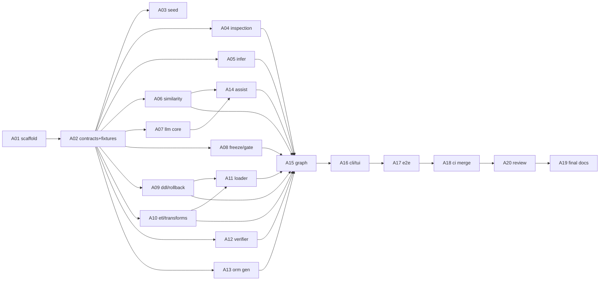

# PLAN.md — SchemaShift build plan

> **Budget:** 2 hours wall-clock. **Staffing:** 1 lead (A00) + 20 subagents (A01–A20), each in its own git worktree.
> **Stack:** Python 3.12 · LangGraph · MongoDB 7 → PostgreSQL 16 · generated ORM = SQLAlchemy 2.0 · Typer + Rich terminal UI · Docker Compose for everything. No frontend, no n8n.
> **Companion docs:** `ARCHITECTURE.md` (design) · `CODEBASE.md` (file map) · `AGENTS.md` (roster + briefs) · `ORCHESTRATION.md` (worktree/merge runbook) · `TESTING.md` · `CICD.md` · `CODE_REVIEW.md` · `openspec/` (specs for every file).

---

## 1. Goal and success criteria

Deliver the **Hard** SchemaShift submission faithfully: inspect a MongoDB sample, infer a relational schema, report a reproducible match %, gate low-confidence mappings, freeze a schema map, generate DDL/ETL/rollback, migrate into PostgreSQL, verify, generate an ORM layer, and orchestrate the whole thing as an explicit LangGraph with human-in-the-loop gates. **Every layer is hybrid**, with the deterministic side owning all side effects.

Done means all of these are true on a clean clone:

1. `docker compose up -d --wait mongo postgres && make demo` runs the full pipeline end to end and exits 0 (LLM in `replay` mode, gate auto-approved with a recorded `ci-auto` approver).
2. `make demo-interactive` runs the same pipeline with the real terminal approval prompt at the gate.
3. Re-running with the same inputs produces **byte-identical** `migrations/`, `etl/`, `orm/` and the same `map_hash` (`scripts/check_determinism.sh`).
4. The pipeline completes with `LLM_PROVIDER=none` (deterministic fallbacks only); frozen map and scripts are identical to the LLM-on run.
5. `make test` (unit + integration + e2e) is green; core-module coverage ≥ 85 %.
6. `python scripts/check_specs.py` passes: every source file appears in an OpenSpec spec table and carries a `Spec:` header.
7. README contains the layer table (layer → deterministic → non-deterministic → justification → safety gate → match-%) and local run commands.
8. `docs/zero-downtime.md` exists (bonus; design-only is accepted by the task).

## 2. Decisions locked before coding

| # | Decision | Reason |
|---|---|---|
| D1 | LangGraph only; skip n8n | Task says "n8n and/or LangGraph"; one orchestrator saves ~20 min |
| D2 | All Python; generated ORM is **SQLAlchemy 2.0** (models + repositories), source app uses native `pymongo` | Task lists Prisma/Drizzle/TypeORM/Sequelize as *examples*; "native Mongo driver → one ORM" is the required concrete path. Stretch (only if idle): emit a text `schema.prisma` from the same map |
| D3 | Source Mongo 7, target Postgres 16 | Named in the task |
| D4 | LLM is optional. Providers: `none` (default), `replay` (committed cache, used in CI), `anthropic` | Reproducibility; demo never breaks on API failure |
| D5 | LLM output goes to **sidecar files** (`*.notes.md`) or to **proposals** that deterministic validators accept/reject. It never edits SQL/ORM bodies and never touches a DB | "Never the sole writer of production side effects" |
| D6 | Terminal UI = Typer + Rich; gate = LangGraph `interrupt()` resumed from the CLI | Required HITL without a frontend |
| D7 | Root tables: `id CHAR(24)` PK (ObjectId hex). Child tables: identity `BIGINT` PK + FK + `position` | Simple, order-independent FK loading |
| D8 | Checkpointer: SQLite file on the `workspace` volume | No extra service |
| D9 | Spec-first with the OpenSpec layout; every source file is a row in a spec table | "Documentation of every single file" |
| D10 | One squash-merged conventional commit per agent branch; **documentation is the last commit** | Requested history shape |
| D11 | Thresholds: auto-accept ≥ 0.85; 0.60–0.85 "guessed" (approval required); < 0.60 "needs_review" (approval required, never auto-approved in CI) | One documented gate threshold |
| D12 | Zero-downtime = written design only. SQL→NoSQL = out of scope (documented as future work) | Task accepts a design doc for the bonus |

## 3. Timeline (T = minutes from start)

| Wave | Window | Agents (parallel) | Output |
|---|---|---|---|
| W0 | T+0 → T+10 | A01, A02 (+ lead imports these docs) | Scaffold, contracts, fixtures |
| W1 | T+10 → T+40 | A03, A04, A05, A06, A07, A08, A09, A10, A18 (A18 drafts only), A19 (check_specs script only) | Inspect → infer → score → freeze → scripts |
| W2 | T+40 → T+65 | A11, A12, A13, A14, A17 (integration tests for merged modules) | Migrate, verify, ORM, assist |
| W3 | T+65 → T+85 | A15, A16, A17 (e2e scaffolding) | Graph + CLI/TUI |
| W4 | T+85 → T+105 | A17 (e2e), A18 (merge CI), A20 (review passes), owners (fixes) | Tests, CI, hardening |
| W5 | T+105 → T+120 | A19 (final docs), lead (tag) | Docs commit, `v1.0.0` |

The human bottleneck is merging and reviewing, not coding. See §7 for the five human gates (≈ 40 min total, overlapped with agent work).

## 4. Dependency graph



**Fixtures as contracts:** A02 hand-authors `tests/fixtures/shop/*` (profile, draft map, similarity report, frozen map, ETL plan, expected DDL/rollback). Every downstream agent codes and tests against those fixtures, so nobody waits on an upstream implementation.

## 5. Phases, agents, commits

Commit format: `type(scope): subject` with trailers `Agent: Axx` and `Spec: <capability>`. Each phase ends with its commit(s) on `main`, produced by `scripts/wt_merge.sh` (squash).

### P0 — Bootstrap (W0)
- **C00** (lead): `git init`, add these planning docs and `openspec/`. → `docs: add plan, architecture, agent roster and openspec baseline`
- **A01 scaffold** (`agent/01-scaffold`): `pyproject.toml` (uv, dev group), ruff/mypy/pytest config, `Dockerfile` (python:3.12-slim, non-root), `docker-compose.yml` (`mongo`, `postgres`, `schemashift`, `tests` profile) with healthchecks, `Makefile`, pre-commit, empty package skeleton, `tests/conftest.py`. Exit: `make verify-fast` green; `docker compose config` valid. → **C01** `chore: scaffold project, tooling, dockerfile and compose stack`
- **A02 contracts** (`agent/02-contracts`): `contracts/*`, `config.py`, `errors.py`, `identifiers.py`, fixtures in `tests/fixtures/shop/`. Exit: fixtures round-trip through the pydantic models; JSON-schema snapshot test. → **C02** `feat(contracts): schema map, profile, report models, config and fixtures`
- **H1** human review of contracts + fixtures (5 min).

### P1 — Source understanding (W1)
- **A03 seed** → **C03** `feat(sample): deterministic nested mongo seed and sample apps`
- **A04 inspection** → **C04** `feat(inspect): deterministic sampler, type stats, redaction, profile builder`
- **A05 infer** → **C05** `feat(infer): rule-based nesting, reference, key and type inference`
- Exit: on the seeded Mongo, `schemashift inspect` produces a profile equal to the fixture; `infer` produces a draft map equal to the fixture draft map (modulo documented diffs).

### P2 — Scoring, freezing, LLM core (W1)
- **A06 similarity** → **C06** `feat(similarity): normalization, scoring engine and match report`
- **A07 llm-core** → **C07** `feat(llm): provider abstraction, replay cache and output guard`
- **A08 freeze-gate** → **C08** `feat(freeze): approval gate, overrides, canonical hash and freezer`
- Exit: match % reproduces on the fixture; the gate flags the messy `reviews.rating` field; freeze is idempotent; unfrozen maps are rejected downstream.
- **H2** human review of inference output on seed, scoring numbers, gate logic (10 min).

### P3 — Script generation (W1)
- **A09 ddl-gen** → **C09** `feat(gen): reproducible DDL and rollback generation`
- **A10 etl-gen** → **C10** `feat(gen): ETL plan, typed transforms and ETL documentation`
- Exit: generated output is byte-equal to `ddl.expected.sql`, `rollback.expected.sql`, `etl_plan.json`; DDL applies cleanly to a fresh Postgres.

### P4 — Migrate and verify (W2)
- **A11 loader** → **C11** `feat(migrate): FK-ordered batched loader with loud row-level failures`
- **A12 verifier** → **C12** `feat(verify): counts, checksums, spot-checks, orphan detection`
- Exit: full seed loads; injected orphan/bad-date seeds fail loudly with actionable errors; verifier passes on a clean load and fails on a tampered row.

### P5 — ORM and assist (W2)
- **A13 orm-gen** → **C13** `feat(orm): sqlalchemy models, repositories and crud demo generation`
- **A14 assist** → **C14** `feat(assist): llm suggest/explain/diagnose nodes with deterministic fallbacks`
- Exit: generated ORM passes `py_compile`, imports, and the CRUD demo round-trips against migrated Postgres; every assist function works with provider `none`.

### P6 — Orchestration and terminal UI (W3)
- **A15 graph** → **C15** `feat(graph): hybrid langgraph pipeline with interrupts, loops and checkpoints`
- **A16 cli-tui** → **C16** `feat(cli): typer commands and rich terminal ui with approval prompts`
- Exit: `make demo` green; interrupt → `resume` works across processes.
- **H4** (early look) run `make demo-interactive`, read the TUI (10 min).

### P7 — Integration, e2e, CI/CD (W2–W4)
- **A17 tests** → **C17** `test: integration, e2e, determinism and failure-injection suites`
- **A18 cicd** → **C18** `ci: github actions pipeline, image scan and release workflow`
- **H3** human review of DDL/ETL templates, loader FK ordering, verifier checksum logic (10 min, run during W2).

### P8 — Review and hardening (W4)
- **A20 review** runs review points RP1–RP4 (see `CODE_REVIEW.md`). Findings are dispatched back to the owning agent. → **C19..C1n** `fix(<scope>): <finding id> …` (one commit per review point, e.g. `fix(review): RP3 findings`).

### P9 — Documentation (W5, the last commit)
- **A19 docs** (`agent/19-docs`): finish `README.md` (layer table, commands, sample report output pasted from a real run), reconcile `openspec/` and `CODEBASE.md` with the code, write `docs/hybrid-layers.md`, `docs/zero-downtime.md`, `docs/operations.md`, regenerate the file index. → **C20** `docs: final readme, hybrid layer justification, spec reconciliation, zero-downtime design`
- **H5** final human review, then `git tag v1.0.0`.

### Expected `git log --oneline` (oldest first)
```
C00 docs: add plan, architecture, agent roster and openspec baseline
C01 chore: scaffold project, tooling, dockerfile and compose stack
C02 feat(contracts): schema map, profile, report models, config and fixtures
C03 feat(sample): deterministic nested mongo seed and sample apps
C04 feat(inspect): deterministic sampler, type stats, redaction, profile builder
C05 feat(infer): rule-based nesting, reference, key and type inference
C06 feat(similarity): normalization, scoring engine and match report
C07 feat(llm): provider abstraction, replay cache and output guard
C08 feat(freeze): approval gate, overrides, canonical hash and freezer
C09 feat(gen): reproducible DDL and rollback generation
C10 feat(gen): ETL plan, typed transforms and ETL documentation
C11 feat(migrate): FK-ordered batched loader with loud row-level failures
C12 feat(verify): counts, checksums, spot-checks, orphan detection
C13 feat(orm): sqlalchemy models, repositories and crud demo generation
C14 feat(assist): llm suggest/explain/diagnose nodes with deterministic fallbacks
C15 feat(graph): hybrid langgraph pipeline with interrupts, loops and checkpoints
C16 feat(cli): typer commands and rich terminal ui with approval prompts
C17 test: integration, e2e, determinism and failure-injection suites
C18 ci: github actions pipeline, image scan and release workflow
C19 fix(review): review-point findings (one or more commits)
C20 docs: final readme, hybrid layer justification, spec reconciliation, zero-downtime design
```

## 6. Traceability: task requirement → owner → spec → proof

| Task requirement | Owner | Spec | Proof |
|---|---|---|---|
| F1 Inspect + infer (hybrid), frozen map after gate | A04 A05 A08 A14 | inspect, infer, freeze-gate, llm-assist | `test_sampler`, `test_infer_*`, `e2e/test_happy_path` |
| F2 Similarity report, overall/entity/field %, normalize→score, low-confidence surfaced | A06 | similarity | `test_scoring`, golden `similarity.json` |
| Non-det requirement 4: gate below threshold | A08 | freeze-gate | `test_gate`, `e2e/test_gate_interrupt` |
| F3 DDL + ETL + rollback, persisted in `migrations/ etl/ orm/` | A09 A10 | scriptgen | golden byte-equality, `check_determinism.sh` |
| F4 Deterministic load, integrity, type conversion, progress, verification, fail loudly | A11 A12 | migrate, verify | `integration/test_loader`, `test_failure_injection` |
| F4 Assisted recovery only after re-freeze | A14 A15 | llm-assist, orchestration | `e2e/test_remap_refreeze` |
| F5 ORM layer + CRUD + manual-review notes | A13 | orm | `integration/test_orm_crud` |
| F6 Explicit graph, both sides per stage, similarity before approval, runnable | A15 | orchestration | `e2e/*`, README graph section |
| F7 Thin seed, nested | A03 | sample | `test_seed` |
| Hybrid README table + run commands | A19 | delivery | manual + `check_specs` |
| Bonus: interactive schema review | A08 A16 | freeze-gate, cli-tui | overrides + approval prompt tests |
| Bonus: zero-downtime | A19 | delivery | `docs/zero-downtime.md` |
| Bonus: SQL→NoSQL | — | — | documented non-goal |

## 7. Human gates

| Gate | When | Look at | Time |
|---|---|---|---|
| H1 | T+10 | contracts, fixtures, compose file | 5 min |
| H2 | T+40 | `infer` output on seed, scoring numbers, gate decisions, freeze hash logic | 10 min |
| H3 | T+65 | DDL/ETL templates, loader FK order + transaction handling, verifier checksum logic | 10 min |
| H4 | T+85 | `make demo-interactive`, TUI readability, generated ORM | 10 min |
| H5 | T+105 | reviewer findings, README, tag | 5 min |

## 8. Risks and the cut list

| Risk | Mitigation |
|---|---|
| Merge conflicts across 9 parallel branches | Strict per-file ownership (`AGENTS.md` §3); shared files only via A01; lead is the only merger |
| Contract churn after W0 | Contracts frozen at H1; changes need a `.agents/requests/` ticket approved by lead |
| Postgres/Mongo startup flakiness | Compose healthchecks + `--wait`; tests use retry fixture |
| LLM flakiness | Default provider `none`; CI uses `replay` |
| Verifier shares transform code with loader (blind spot) | Independent comparator in spot-check + golden transform tests (documented limitation) |
| Time overrun | Cut in this order: (1) `anthropic` provider (keep `none`/`replay`), (2) hypothesis property tests, (3) per-file spec rows for templates/prompts → directory-level, (4) Trivy + release job, (5) `pg_array` option, (6) zero-downtime doc → outline only |

## 9. Definition of Done (every agent branch)

- Code + unit tests inside owned paths only; `make verify-fast` green in the worktree.
- Every new source file has a `Spec: <capability>/<stem>` line in its module docstring and a row in the owning spec table.
- No SQL built by string-formatting values; identifiers only through `identifiers.quote_ident`.
- No LLM call outside `llm/` + `assist/`; no DB handle passed to anything in `assist/`.
- Handoff note written to `.agents/handoff/<NN>-<slug>.md` (what exists, how to run, known gaps).
